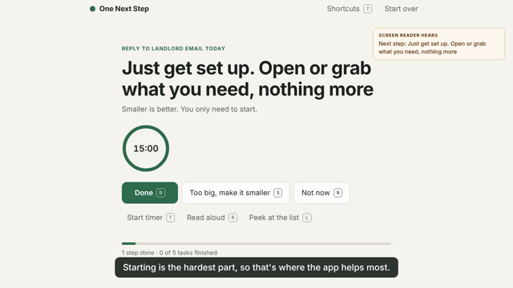

# One Next Step

Turns an overwhelming to-do list into one calm next action.

Built for **Maya**, a student with ADHD who freezes when she sees a long list (task paralysis). The barrier is not a lack of tools; it is that a full list makes it impossible to choose where to start.



## How it works

1. **Brain dump.** Paste or type everything, one thing per line. Say how much energy you have and how long you can focus.
2. **One step.** The app hides the list and shows a single, concrete action you can start in under two minutes, with a one-line reason it was picked (urgent words like "today", deadlines, your energy level, momentum).
3. **Keep going.** Done (`D`) shows the next step of the same task. Too big (`S`) splits the step into something smaller. Not now (`N`) moves the task to later without guilt.
4. **Finish.** The end screen shows what you did, not what is left.

## Accessibility

- Every action has a single-key shortcut (`?` lists them) and works with Tab and Enter.
- New steps, timer events and finished tasks are announced through an `aria-live` region; focus moves to the new step.
- Read aloud (`R`) uses the browser's speech synthesis.
- Large type, 48px touch targets, visible focus rings, dark mode, and `prefers-reduced-motion` support.

## Run it

No build, no backend, no account. Open `index.html` in any modern browser, or serve the folder:

```
python3 -m http.server 8000
```

Progress is saved in `localStorage` on the device. Nothing is sent anywhere.

## Demo video

`demo/` holds the scripts used to make the demo video: `record.js` drives the app with Playwright and records the screen, and `tts.py` generates the voiceover locally with the open-source Kokoro text-to-speech model.

## Limitations

- Step suggestions come from keyword-based recipes, not a language model, so unusual tasks get a generic three-step plan.
- Urgency detection only reads words in the task ("today", "friday", "due").
- Progress lives in one browser; there is no sync between devices.
- Not yet tested with real users with ADHD or with every screen reader.

## Built with

HTML, CSS and vanilla JavaScript. Playwright, ffmpeg and Kokoro TTS for the demo video. Built with help from Claude (Anthropic) as an AI coding assistant.

## License

MIT
